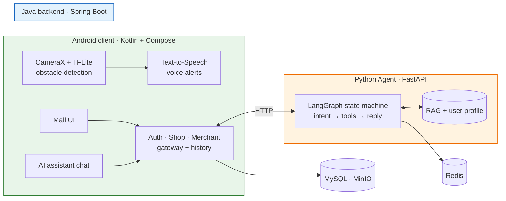

<div align="center">

# Light of Shadow · 音影寻光

**An assistive app for people with visual impairments**

*On-device obstacle detection with voice alerts · an accessibility-first mall · an AI shopping assistant that remembers your budget*

<br>

[](https://github.com/flypiggpt/light-of-shadow/releases)
[](#testing--quality)
[](#testing--quality)
[](https://github.com/flypiggpt/light-of-shadow/actions)
[](https://github.com/flypiggpt/light-of-shadow/actions)
[](LICENSE)
[](https://github.com/flypiggpt/light-of-shadow)
[](https://github.com/flypiggpt/light-of-shadow)
[](https://github.com/flypiggpt/light-of-shadow)

<br>

**English** | [简体中文](README.zh-CN.md)

**Download the APK: [Release v0.1.0](https://github.com/flypiggpt/light-of-shadow/releases/tag/v0.1.0)**

</div>

---

## Tech Stack

<p align="center">
  
</p>

---

## Why This Project

| | |
|:--|:--|
| **Distance-first perception** | The detector answers *"what is ahead"* and speaks it aloud — a detection miss never becomes a missed warning. A depth pipeline (in research) adds *"how far"* on top. |
| **Real AI engineering** | LangGraph state machine · hybrid RAG retrieval · cross-session user memory · 9 business tools · golden-set evaluation wired into CI — not a bare LLM chat call. |
| **Quality gates as first-class** | 129 automated tests · 40-case golden eval on **real routing** · CI blocks merges when quality drops below baseline. |
| **Accessibility throughout** | TTS for guide alerts, assistant replies and checkout flows · TalkBack semantics on every control. |

---

## Architecture



- **Client** — perception runs fully on-device; the mall talks to the Java backend
- **Java backend** — modular monolith (no Spring Cloud at this scale) and the **gateway to the Agent**: injects user identity, persists conversation history
- **Python Agent** — owns all intelligence: state machine, tools, RAG, memory, eval and observability (Langfuse traces · Prometheus metrics · golden-set regression)

---

## Features

### Guide (client)
- Real-time obstacle detection (COCO classes, Chinese labels) — local TFLite, zero cloud dependency
- Voice alerts with direction, cooldown and rate limiting — never spams
- Adjustable speech rate · toggleable announcements

### Mall (client + backend)
- Products · keyword search · cart · checkout · mock payment · cancel · delete · address book
- Merchant admin (`light-of-shadow-merchant/`, Vue3 + Element Plus): product CRUD + presigned image upload

### AI Shopping Assistant (Agent)
- **12 intents** on a LangGraph state machine: tool routing · bounded clarify loops · graceful degradation
- **Memory preferences** — remembers budget / preferences / recent purchases; stops re-asking
- **Order tools** — query / track / cancel / delete orders in natural language
- **RAG FAQ** — facts come from retrieval, not from model memory

---

## Repository Layout

```
light-of-shadow/
├── light-of-shadow-client/     # Android · Kotlin + Compose + CameraX + TFLite
├── light-of-shadow-backend/    # Java 21 · Spring Boot 3 · MyBatis
├── light-of-shadow-merchant/   # Merchant web · Vue3 + Element Plus
├── agent-service/              # Python Agent · FastAPI + LangGraph + RAG + eval
├── tools/                      # Model export (Depth Anything → TFLite)
├── docs/                       # API contracts · DB schema · guides
└── .github/workflows/          # Quality gates: agent-quality · backend-quality
```

---

## Quick Start

### Android client

```bash
cd light-of-shadow-client
./gradlew :app:assembleDebug       # or .\gradlew.bat on Windows
bash install-debug.sh              # build + install + launch via adb
```

Point at a local backend via `local.properties`: `api.base.url=http://10.0.2.2:8080`

### Java backend

```bash
cd light-of-shadow-backend
cp src/main/resources/application-example.yaml src/main/resources/application.yaml   # fill env
mysql -u root -p light_of_shadow < docs/db/mysql_schema.sql                          # + shop/shoppingguide sql
mvn test && mvn package && java -jar target/light-of-shadow-backend-*.jar
```

Remote deploy: `./deploy-remote.sh deploy`

### Python Agent

```bash
cd agent-service
cp .env.example .env               # AGENT_LLM_API_KEY (DeepSeek)
docker compose up -d --build       # app + redis on :8000
```

### Merchant web

```bash
cd light-of-shadow-merchant && npm install && npm run dev
```

---

## Testing & Quality

| Layer | Suite | Command |
|:--|:--|:--|
| Agent unit + HTTP | **95 + 1 LLM-gated** | `pytest tests/` |
| Golden eval | **40 cases** · real routing · temp 0 | `python tests/golden/run_eval.py` |
| Java | **33 tests** · H2 · zero deps | `mvn test` |
| CI gates | agent-quality · backend-quality | every PR |

> **The golden eval runs real intent routing and is gated by a baseline** — drop below the floor and CI goes red, blocking the merge. Eval reports attach as CI artifacts.

---

## API Docs

| Doc | Coverage |
|:--|:--|
| [auth_api.md](docs/api/auth_api.md) | login · register · token refresh & rotation |
| [shop_api.md](docs/api/shop_api.md) | products · cart · orders · addresses |
| [shoppingguide_api.md](docs/api/shoppingguide_api.md) | AI assistant · sessions · messages · profile |
| [merchant_api.md](docs/api/merchant_api.md) | merchant product management |

---

## Known Limitations

> This is a portfolio project, not a production service.

- **Mock payment** — no real payment or logistics
- **Debug-signed APK** — allow "unknown sources"; release signing planned
- **APK ~105MB** — TFLite native libs x3 ABIs + unminified debug dex; ABI split / R8 planned
- **minSdk 36** (Android 16+) — validated on the dev device
- Verification codes run in dev mode unless SMTP is configured

---

## Roadmap

- **On-device metric distance** *(research branch, shelved)* — depth discovers obstacles with meter-level distance, the detector only labels them. 51 unit tests green on the feature branch.
- Release signing + APK size optimization
- Accessibility S4: structured voice summaries

---

<div align="center">

**[Download](https://github.com/flypiggpt/light-of-shadow/releases/tag/v0.1.0)** · **[Demo](http://132.232.75.62)** · **[Docs](docs/api/)** · **[English](README.md) · [简体中文](README.zh-CN.md)**

Apache 2.0 · [CONTRIBUTING.md](CONTRIBUTING.md) · [SECURITY.md](SECURITY.md)

</div>
