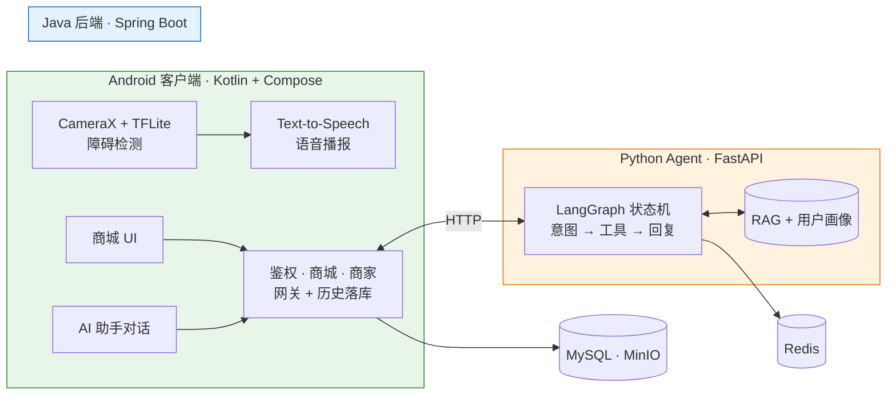

<div align="center">

# 音影寻光 · Light of Shadow

**面向视障用户的辅助应用**

*端侧障碍检测与语音播报 · 无障碍优先的商城 · 一位记得你预算的 AI 购物助手*

<br>

[](https://github.com/flypiggpt/light-of-shadow/releases)
[](#测试与质量)
[](#测试与质量)
[](https://github.com/flypiggpt/light-of-shadow/actions)
[](https://github.com/flypiggpt/light-of-shadow/actions)
[](LICENSE)
[](https://github.com/flypiggpt/light-of-shadow)
[](https://github.com/flypiggpt/light-of-shadow)
[](https://github.com/flypiggpt/light-of-shadow)

<br>

[English](README.md) | **简体中文**

**下载 APK：[Release v0.1.0](https://github.com/flypiggpt/light-of-shadow/releases/tag/v0.1.0)** · 测试账号：`shopowner/shop123456`（商家）· `yan/yan`（用户）

</div>

---

## 技术栈

<p align="center">
  
</p>

---

## 为什么值得看

| | |
|:--|:--|
| **距离优先的端侧感知** | 检测器回答"前方是什么"并语音播报——**漏识别永不漏报**；米制测距管线在研，负责"有多远"。 |
| **有工程含量的 AI** | LangGraph 状态机 · 混合 RAG 检索 · 跨会话用户记忆 · 9 个业务工具 · golden 评测进 CI——不是裸调一个 LLM。 |
| **质量门禁是一等公民** | 129 项自动化测试 · 40 条 golden 样例对**真实路由**评测 · 质量跌破基线 CI 直接挡合并。 |
| **无障碍贯穿始终** | 导盲播报、助手回复、下单结果全部 TTS 朗读 · 交互控件带 TalkBack 语义。 |

---

## 架构



- **客户端**——感知完全在端侧；商城对接 Java 后端
- **Java 后端**——模块化单体（这个体量不上 Spring Cloud），同时是 **Agent 网关**：注入用户身份、持久化对话历史
- **Python Agent**——承载全部智能：状态机、工具、RAG、记忆、评测与可观测（Langfuse trace · Prometheus 指标 · golden 回归）

---

## 功能

### 导盲（客户端）
- 实时障碍检测（COCO 类别 + 中文标签）——本地 TFLite，零云端依赖
- 语音播报带方向、冷却、限流——绝不轰炸
- 语速可调 · 播报可关

### 商城（客户端 + 后端）
- 商品 · 关键词搜索 · 购物车 · 下单 · 模拟支付 · 取消 · 删除 · 地址簿
- 商家后台（`light-of-shadow-merchant/`，Vue3 + Element Plus）：商品增删改 + 预签名图片直传

### AI 购物助手（Agent）
- **12 种意图**的 LangGraph 状态机：工具路由 · 有界追问 · 优雅降级
- **记忆偏好**——记住预算/偏好/最近购买，不再重复追问
- **订单工具**——自然语言查单/看物流/取消/删除
- **RAG 问答**——事实来自检索，不是模型编

---

## 目录结构

```
light-of-shadow/
├── light-of-shadow-client/     # Android · Kotlin + Compose + CameraX + TFLite
├── light-of-shadow-backend/    # Java 21 · Spring Boot 3 · MyBatis
├── light-of-shadow-merchant/   # 商家后台 · Vue3 + Element Plus
├── agent-service/              # Python Agent · FastAPI + LangGraph + RAG + 评测
├── tools/                      # 模型转换（Depth Anything → TFLite）
├── docs/                       # API 契约 · 数据库 · 指南
└── .github/workflows/          # 质量门禁：agent-quality · backend-quality
```

---

## 快速开始

### Android 客户端

```bash
cd light-of-shadow-client
./gradlew :app:assembleDebug       # Windows 用 .\gradlew.bat
bash install-debug.sh              # 构建 + 安装 + 启动（adb）
```

本地联调后端：`local.properties` 里写 `api.base.url=http://10.0.2.2:8080`

### Java 后端

```bash
cd light-of-shadow-backend
cp src/main/resources/application-example.yaml src/main/resources/application.yaml   # 填环境变量
mysql -u root -p light_of_shadow < docs/db/mysql_schema.sql                          # + shop/shoppingguide 脚本
mvn test && mvn package && java -jar target/light-of-shadow-backend-*.jar
```

远程部署：`./deploy-remote.sh deploy`

### Python Agent

```bash
cd agent-service
cp .env.example .env               # AGENT_LLM_API_KEY（DeepSeek）
docker compose up -d --build       # app + redis，端口 8000
```

### 商家后台

```bash
cd light-of-shadow-merchant && npm install && npm run dev
```

---

## 测试与质量

| 层 | 套件 | 命令 |
|:--|:--|:--|
| Agent 单测 + HTTP | **95 + 1 LLM 门禁** | `pytest tests/` |
| Golden 评测 | **40 条** · 真实路由 · 温度 0 | `python tests/golden/run_eval.py` |
| Java | **33 项** · H2 · 零依赖 | `mvn test` |
| CI 门禁 | agent-quality · backend-quality | 每个 PR |

> **golden 评测跑真实意图路由并受基线约束**——跌破底线 CI 变红、挡合并；评测报告自动挂 CI artifact。

---

## API 文档

| 文档 | 覆盖 |
|:--|:--|
| [auth_api.md](docs/api/auth_api.md) | 登录 · 注册 · 令牌刷新轮换 |
| [shop_api.md](docs/api/shop_api.md) | 商品 · 购物车 · 订单 · 地址 |
| [shoppingguide_api.md](docs/api/shoppingguide_api.md) | AI 助手 · 会话 · 消息 · 画像 |
| [merchant_api.md](docs/api/merchant_api.md) | 商家商品管理 |

---

## 已知限制

> 这是作品集项目，不是生产服务。

- **模拟支付**——无真实支付与物流
- **debug 签名 APK**——安装需允许"未知来源"；release 签名在计划中
- **APK 约 105MB**——3 个 ABI 的 TFLite 原生库 + 未混淆 debug dex；ABI 拆分 / R8 在计划中
- **minSdk 36**（Android 16+）——目前仅在开发机型验证
- 验证码走开发模式（不真发邮件），除非配好 SMTP

---

## 路线图

- **端侧米制测距**（在研分支，暂搁置）——深度发现障碍并给距离、检测器只管命名；分支上 51 项单测已全绿
- release 签名 + APK 瘦身
- 无障碍 S4：结构化语音摘要

---

<div align="center">

**[下载](https://github.com/flypiggpt/light-of-shadow/releases/tag/v0.1.0)** · **[演示](http://132.232.75.62)** · **[文档](docs/api/)** · **[English](README.md) · [简体中文](README.zh-CN.md)**

Apache 2.0 · [CONTRIBUTING.md](CONTRIBUTING.md) · [SECURITY.md](SECURITY.md)

</div>
