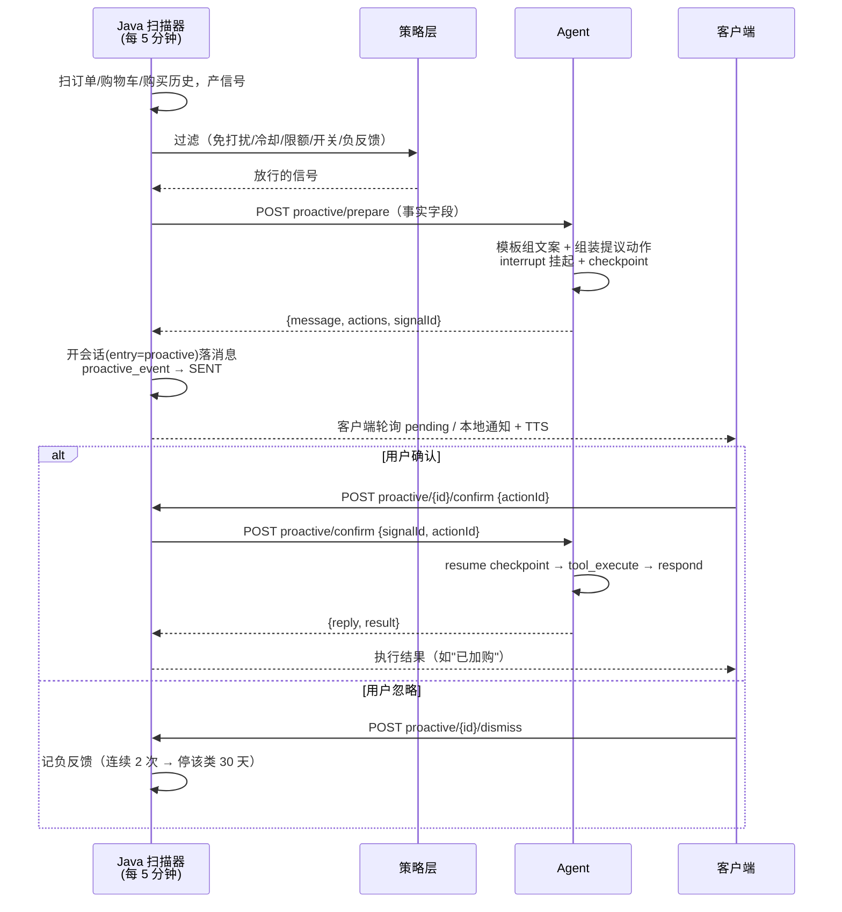

# 主动式 Agent 改造方案（Proactive Agent）

状态：设计稿，未实施。实施顺序按 §11 的 PR 链走，**本文档先于代码合并**。

一句话：把 Agent 从「你问我答」改成「它先开口，说完挂着等你确认」。视障用户感知不到订单状态和价格变化，明眼人扫一眼列表就知道该催单、该退货一单、该趁降价回购，Agent 替他盯这些状态。

---

## 1. 背景与目标

现状问题：Agent 是纯被动的对话服务——用户不发消息，系统永远沉默。而购物里有一类事件是「用户还没意识到需要行动」：订单没支付、刚下的单疑似误触、买过的商品降价了、购物车放凉了。这类事件有两个特点：

1. **有时间窗**——晚了就错过（订单关闭、断货、售后超时）；
2. **需要确认**——动作有副作用（支付、加购），不能替用户做主。

这两点正好对应本方案的两个核心机制：**事件扫描**（Java 定时任务）和 **interrupt 确认流**（LangGraph 挂起/恢复）。

目标（按优先级）：

| # | 目标 | 验收 |
|---|---|---|
| 1 | 4 类主动信号能触发、能确认、能执行 | §13 演示脚本走通 |
| 2 | 策略层防骚扰生效 | 免打扰/冷却/负反馈均有测试 |
| 3 | interrupt + checkpoint 成为核心机制（不是摆设） | 确认跨小时仍能恢复执行 |
| 4 | 评测覆盖主动链路 | 离线回放集进 CI |

非目标见 §12。

---

## 2. 名词

| 名词 | 含义 |
|---|---|
| 信号（signal / event） | 扫描器检测到的一个「该开口了」的事实，如「订单 X 未支付」 |
| 策略层 | 发送前的规则过滤：免打扰、冷却、限额、负反馈、用户开关 |
| 提议（proposal） | 推给用户的一条消息 + 若干动作按钮，如「这单是本人操作吗？〔保留〕〔取消订单〕」 |
| 挂起（parked） | 提议发出后 Agent 侧停在 interrupt 节点、状态已 checkpoint 的中间态 |
| 确认（confirm） / 忽略（dismiss） | 用户对提议的两种响应；确认从 checkpoint 恢复并执行工具 |

---

## 3. 触发信号定义

四个信号全部基于**现有表结构**可算，不需要新采集数据。`proactive_event` 表见 §8。

**全部面向用户**：只服务买家（提醒他该做的事），不做商家侧提醒（订单积压/库存预警/销量异动，见 §12）。

动作分两类：**工具动作**（Agent 恢复后执行工具，如 `add_cart`/`cancel_order`）和**客户端动作**（confirm 后客户端直接调商城 API 或导航，如去购物车、删购物车项）。两类都走 confirm 统一入口。

### 3.1 S1 待支付催付（`UNPAID_ORDER`）

| 项 | 内容 |
|---|---|
| 检测 | `shop_order.status = 'PENDING_PAYMENT'` 且 `created_at` 距今 5 分钟以上 |
| 提醒一次 | 每单只提醒一次（dedupe_key = `UNPAID_ORDER:{orderId}`） |
| 文案模板 | "你有一笔 {商品名} 订单还没支付（{金额} 元），{剩余分钟} 分钟内不支付会自动关闭，要继续支付吗？" |
| 动作 | 〔继续支付〕→ `pay`（复用 `POST /api/shop/orders/{id}/pay`）；〔取消订单〕→ `cancel_order` 工具 |
| 配套任务 | **超时关单**：`PENDING_PAYMENT` 超过 30 分钟 → 自动取消、恢复库存。没有这个任务，"自动关闭"就是空话 |

数据来源：`shop_order` + `shop_order_item.product_name`（名称快照）+ `total_cent`。金额、商品名直接取库，不进 LLM。

### 3.2 S2 误操作守护（`DUP_ORDER`）

视障用户触屏误触概率远高于明眼人——重复下单、数量划错是真实痛点。这是**保护型**信号，和营销无关，优先级最高。

| 项 | 内容 |
|---|---|
| 检测（触发器 T1 重复单） | 同一用户 10 分钟内对同一 `product_id` 创建 ≥ 2 笔未取消订单（`shop_order` join `shop_order_item`） |
| 检测（触发器 T2 数量异常） | 单笔某商品数量 ≥ 5 且 ≥ 该用户该商品历史均量 × 3（有过 ≥ 2 次购买记录才判定，防误伤新用户） |
| 时机 | **下单完成后异步立即检测**（事件驱动，不等定时扫描），要抢在支付前开口 |
| 提醒一次 | 每单只提醒一次（dedupe_key = `DUP_ORDER:{orderId}`） |
| 文案模板 | T1："你刚下了两单 {商品名}，是重复下单吗？要帮你取消一单吗？"；T2："这单 {商品名} × {数量}，比你平时多不少，确定吗？" |
| 动作 | 〔取消后一单〕→ `cancel_order` 工具；〔都保留〕→ dismiss |

数据来源：`shop_order` + `shop_order_item`，全程客户端无感、不需要用户配置。

### 3.3 S3 购物车闲置（`CART_IDLE`）

| 项 | 内容 |
|---|---|
| 检测 | `cart_item.created_at` 距今 ≥ 3 天且未下单 |
| 提醒间隔 | 同商品 7 天最多一次，整类每天最多 1 条（dedupe_key = `CART_IDLE:{userId}:{productId}`） |
| 文案模板 | "购物车里的 {商品名} 放了 {N} 天，现在要下单吗？" |
| 动作 | 〔去购物车〕→ 客户端导航；〔清掉这件〕→ `DELETE /api/shop/cart/items/{itemId}`（payload 携带 itemId）；〔不用了〕→ dismiss |
| 边界 | 商品已下架/无货时文案改说"没货了"，动作只剩〔清掉这件〕 |

数据来源：`cart_item` join `product`。

### 3.4 S4 买过的商品降价（`PRICE_DROP`）

设计巧思：**不需要价格历史表**——用户自己的成交单价（`shop_order_item.unit_price_cent`）就是历史价。这不是全网降价广播（那是营销），是"你买贵了/值得回购"的个人化提醒，所以是用户侧信号。

| 项 | 内容 |
|---|---|
| 检测 | 用户买过的商品，当前 `product.price_cent` < 历史成交价 × 0.9（降幅 ≥ 10% 才提醒，防微小波动骚扰） |
| 提醒间隔 | 每商品每价位 30 天一次，再降再提（dedupe_key = `PRICE_DROP:{userId}:{productId}:{price_cent}`） |
| 文案模板 | "你 {N} 天前 {旧价} 元买的 {商品名}，现在只要 {新价} 元，要再买一件吗？" |
| 动作 | 〔再买一件〕→ `add_cart` 工具（quantity=1）；〔不用了〕→ dismiss |

数据来源：`shop_order_item`（历史成交价）join `product`（现价）。

### 3.5 信号优先级

同一用户同一时刻可能命中多个信号：`DUP_ORDER` > `UNPAID_ORDER` > `CART_IDLE` > `PRICE_DROP`。保护型 > 时间窗型 > 提醒型。全局限额（§5）内按优先级发放，超出的顺延到下轮扫描。

---

## 4. 总体流程



要点：

- **检测与策略在 Java**——数据在 MySQL，Java 是唯一有库连接的服务；Agent 不做调度。
- **文案与执行在 Agent**——事实槽位由模板注入（商品名/金额/天数直接取库），LLM 只做可选润色（默认关，§8.3）。
- **消息落 `sg_message`**——主动消息进正式会话历史，用户后续追问"刚才那单"上下文是连贯的。
- **确认走 interrupt 恢复**，不走新对话——动作参数在挂起时已定死，恢复后直接执行，避免二次解析出错。

---

## 5. 策略层（防骚扰）

主动式 Agent 的生死线。全部规则纯 Java 实现，不走 LLM；每条规则对应独立单测。

| 规则 | 默认值 | 说明 |
|---|---|---|
| 用户总开关 | 开 | `sys_user` 加 `proactive_enabled` 列（或复用设置表）；关了就一个信号都不发 |
| 分类开关 | 全开 | 用户可单独关掉"购物车提醒"类 |
| 免打扰时段 | 22:00–08:00 | 时段内命中的信号**顺延**到 08:00 后发，不丢弃；**`DUP_ORDER` 例外直接发**——误操作守护要抢在支付前，晚了就失去意义 |
| 单类冷却 | S1 每单 1 次；S2 每单 1 次；S3 每商品 7 天 1 次；S4 每商品每价位 30 天 1 次 | dedupe_key 落库唯一约束兜底 |
| 全局限额 | 每用户每天最多 3 条（`DUP_ORDER` 不占额度） | 超额按 §3.5 优先级顺延到次日 |
| 负反馈 | 同类信号连续 2 次 dismiss → 该类停 30 天 | 计数存 `proactive_event`，按类聚合 |
| 确认时效 | 提议 24 小时过期 | 过期自动 dismiss，checkpoint 丢弃 |

放行判定顺序：总开关 → 分类开关 → 免打扰 → 冷却 → 限额 → 负反馈。先便宜的规则先判。

---

## 6. API 契约

统一响应 `{code, message, data}`；客户端接口走 Java 网关（JWT 校验），Agent 内部接口由 Java 带 `X-User-Id` 转发。完整示例落地时并入 `docs/api/shoppingguide_api.md`。

### 6.1 客户端接口（新增，Java 暴露）

| 方法 | 路径 | 说明 |
|---|---|---|
| `GET` | `/api/shoppingguide/proactive/pending` | 拉未读提议（客户端启动/轮询时调），含 `signalId/message/actions[]` |
| `POST` | `/api/shoppingguide/proactive/{signalId}/confirm` | body `{actionId}`；幂等：重复确认返回同一结果 |
| `POST` | `/api/shoppingguide/proactive/{signalId}/dismiss` | 忽略；记负反馈 |
| `GET` | `/api/shoppingguide/proactive/prefs` | 查开关（总开关 + 分类） |
| `PUT` | `/api/shoppingguide/proactive/prefs` | 改开关 |

confirm 返回示例：

```json
{
  "code": 0,
  "data": {
    "signalId": "pe_202606010001",
    "actionId": "add_cart",
    "reply": "已把 500ml 装牛奶 × 1 加入购物车。",
    "executed": true
  }
}
```

### 6.2 Agent 内部接口（新增，Java → Agent）

| 方法 | 路径 | 说明 |
|---|---|---|
| `POST` | `/internal/proactive/prepare` | 入参：信号类型 + 事实字段（orderId/productId/名称/金额/天数）+ `signalId`；出参：`{message, actions[], checkpointThreadId}`；副作用：interrupt 挂起 + checkpoint |
| `POST` | `/internal/proactive/confirm` | 入参：`{signalId, actionId}`；从 checkpoint 恢复 → 执行工具 → 生成确认话术 |
| `POST` | `/internal/proactive/discard` | 入参：`{signalId}`；丢弃挂起态（过期/用户忽略时调） |

prepare 是**无用户输入**的图入口：state 预填 `intent/entities`（如 `add_cart` + `{productId, quantity:1}`），图走 `propose` 节点生成提议后停在 interrupt。confirm 用 LangGraph 的 resume 语义从 checkpoint 取回挂起态，接 `tool_execute → respond` 走完。

---

## 7. 数据模型

新增一张表即可（`docs/db/mysql_proactive_event.sql`，随 PR-2 提交）：

```sql
CREATE TABLE IF NOT EXISTS `proactive_event` (
  `id` VARCHAR(64) NOT NULL COMMENT '信号ID（pe_ 前缀）',
  `user_id` VARCHAR(64) NOT NULL,
  `type` VARCHAR(32) NOT NULL COMMENT 'UNPAID_ORDER/DUP_ORDER/CART_IDLE/PRICE_DROP',
  `dedupe_key` VARCHAR(128) NOT NULL COMMENT '幂等键，唯一约束',
  `ref_id` VARCHAR(64) NOT NULL COMMENT '关联订单ID或商品ID',
  `payload_json` TEXT NOT NULL COMMENT '事实字段快照（商品名/金额/天数等）',
  `status` VARCHAR(16) NOT NULL DEFAULT 'PENDING' COMMENT 'PENDING/SENT/CONFIRMED/DISMISSED/EXPIRED',
  `action_id` VARCHAR(32) DEFAULT NULL COMMENT '用户确认的动作',
  `session_id` VARCHAR(64) DEFAULT NULL COMMENT '写入的导购会话',
  `proposed_at` DATETIME(3) DEFAULT NULL,
  `resolved_at` DATETIME(3) DEFAULT NULL,
  `created_at` DATETIME(3) NOT NULL DEFAULT CURRENT_TIMESTAMP(3),
  PRIMARY KEY (`id`),
  UNIQUE KEY `uk_proactive_dedupe` (`dedupe_key`),
  KEY `idx_proactive_user_status` (`user_id`, `status`, `created_at`)
) ENGINE=InnoDB DEFAULT CHARSET=utf8mb4 COLLATE=utf8mb4_0900_ai_ci COMMENT='主动提醒事件';
```

- 冷却与负反馈的聚合查询直接打这张表（`user_id + type` 计数），不再加表。
- `payload_json` 存事实快照：确认执行时**不再回查**商品名/金额，防执行时刻与提议时刻数据漂移（"说的是 29 元，怎么扣了 35"）。
- 挂起态本身在 Agent 的 Redis checkpoint（`thread_id = signalId`），不进 MySQL——checkpoint 已是既有机制，别造第二个真相源。

---

## 8. Agent 侧改造

### 8.1 图结构（增量，不推倒现有状态机）

现有：`guard → intent → (clarify | tool_route → tool_execute) → respond / degrade`。

新增一条**提议支路**（用户消息入口不变）：

```
propose 节点（唯一新增节点）
  ├─ 生成提议文案（模板 + 事实槽位）
  ├─ 组装 actions[]（按钮语义 → 工具名 + 预填参数）
  └─ interrupt({message, actions}) 挂起 → checkpoint 落盘
```

- `prepare` 入口：state 预填 `intent/entities` 后直接进 `propose`，不跑意图识别（信号是系统产生的，意图是确定的）。
- `confirm` 入口：`Command(resume={actionId})` 恢复 → 按 action 映射到 `tool_execute` → `respond` 生成执行结果话术。
- `discard` / 过期：checkpoint 标记丢弃，图不恢复。

### 8.2 interrupt 语义（为什么这里非它不可）

提议从发出到用户确认可能隔数小时（夜里挂起、早上确认），中间服务可能重启。`interrupt` + checkpoint 天然满足：挂起态持久化、重启可恢复、确认幂等（同一 `signalId` 重复 resume 返回同一结果）。这正是 checkpoint 存在的理由——以前它只是对话历史存储，现在是**跨进程的任务挂起点**。

### 8.3 文案生成

- 默认**纯模板**：事实槽位全部来自 `payload_json`，LLM 不参与——主动消息一句话 30 字以内，模板质量和稳定性都高于 LLM，且零成本零延迟。
- 可选 LLM 润色开关（默认关）：仅在用户开启"自然语气"时过一次模型，失败回退模板。评测里模板路径是必测项，润色路径是可选项。

### 8.4 复用清单

复用：`RedisCheckpointSaver`（挂起态）、`add_cart`/`cancel_order` 工具（参数校验/重试/熔断照旧）、防注入消毒（事实字段进模板前照常消毒）。所有信号的检测都在 Java 侧算（MySQL 是权威数据源），Agent 的 `ProfileStore.recent_orders` 只是副本，不做判定依据。

不复用：`intent_node`（信号类型就是意图，不需要识别）。

---

## 9. Java 侧改造

| 模块 | 内容 |
|---|---|
| 信号扫描器 | `@Scheduled` 每 5 分钟一轮：S1 查 `shop_order`（PENDING_PAYMENT 满 5 分钟）、S3 查 `cart_item` 闲置、S4 比对 `shop_order_item` 历史成交价与 `product` 现价；S2 在下单事务提交后**异步立即**检测（事件驱动，不等扫描轮次）。命中即投递策略层 |
| 超时关单 | 同一轮扫描顺带把 PENDING_PAYMENT 超 30 分钟的单置 `CANCELED`、恢复库存（复用现有取消逻辑） |
| 策略层 | 纯规则类 `ProactivePolicy`，输入信号 + 用户偏好，输出 放行/顺延/丢弃 |
| 事件表读写 | `ProactiveEventMapper`：建事件（dedupe_key 唯一约束兜底幂等）、状态流转、负反馈计数 |
| Agent 网关扩展 | `AgentGatewayClient` 加 `prepare/confirm/discard` 三个转发方法，超时/降级语义沿用现有约定 |
| 对外接口 | §6.1 五个端点，进 `ShoppingGuideController` 或独立 `ProactiveController` |
| 降级 | Agent 不可达时：提议暂缓发送（事件留 PENDING 下轮重试），**不降级成本地 LLM**——主动消息宁可不发，不能发错 |

客户端改动（最小化，不阻塞主线，暂缓实施）：轮询 `pending`（进首页时拉一次）+ 本地通知 + TTS 播报提议文案 + 确认按钮调 confirm。推送通道先用轮询，FCM 不做（§12）。**UI 形态不用弹窗**：S2（误操作守护）在下单结果页插非模态卡片；S1/S3/S4 走系统通知栏（带操作按钮）+ TTS 播报，点进会话卡片再确认。TTS 播报进现有 `TtsAlertManager` 队列，**导盲播报优先级高于购物提议**，冲突时购物播报延后——提醒绝不能打断避障。

---

## 10. 评测

主动链路进不了现有 golden set（那是对话评测），单独做**离线回放集**：

| 层 | 测什么 | 怎么测 |
|---|---|---|
| 信号检测 | 给定订单/历史快照，该不该触发 | 造表数据 fixture，断言信号产出（纯 Java 单测） |
| 策略层 | 免打扰/冷却/限额/负反馈 | 每条规则一组用例，含边界（22:00 整、第 3 次 dismiss） |
| 文案 | 槽位齐全、无编造、长度 ≤ 30 字 | 模板渲染断言（事实字段必须出现在文案中） |
| 确认执行 | confirm → 工具参数正确、幂等 | mock 工具层，断言参数与重复 confirm 行为 |
| 端到端 | 离线回放：一批脱敏订单快照 → 期望提议序列 | `agent-service/tests/proactive/`，报告进 CI artifact |

新增指标（进现有 Prometheus registry）：`proactive_signals_total{type}`、`proactive_sent_total`、`proactive_confirm_total`、`proactive_dismiss_total`、`proactive_expired_total`。确认率是主动式 Agent 的北极星指标。

---

## 11. 任务拆分（PR 链）

| PR | 内容 | 可独立验收 |
|---|---|---|
| PR1 | 本文档 + `proactive_event` 表 SQL + `docs/api/shoppingguide_api.md` 补 §6 契约 | 文档评审 |
| PR2 | Java：扫描器 + 超时关单 + 策略层 + 事件表读写（先只写库和日志，不发消息） | 造数据后库表状态正确 |
| PR3 | Agent：`propose` 节点 + interrupt 挂起/恢复 + `prepare/confirm/discard` 内部接口 | curl 走通挂起→确认→工具执行 |
| PR4 | Java：网关转发 + 对外五端点 + 会话落消息 | 客户端用 curl 代替即可验收 |
| PR5 | 客户端：轮询 + 通知 + TTS + 确认按钮 | §13 演示脚本真机走通 |
| PR6 | 评测：回放集 + 策略层用例 + 指标 | CI 绿 |

依赖：PR2/PR3 可并行；PR4 依赖两者；PR5 依赖 PR4；PR6 可与 PR4/PR5 并行。

---

## 12. 明确不做

- FCM / 厂商推送通道（轮询够用，真机演示不依赖网络推送）
- 商家侧提醒（订单积压、库存预警、销量异动）——本方案只服务用户
- 全网降价广播（要价格历史表；S4 只做"你买过的商品降价"，用成交单价当历史价）
- 多信号合并成"每日摘要"（先保证单条质量）
- 机器学习预测类信号（样本太少，规则可解释、可单测）
- 微信/短信通知渠道

---

## 13. 演示脚本（验收标准）

1. 用户下单不支付 → 5 分钟后 TTS："你有一笔牛奶订单还没支付（29 元），25 分钟内不支付会自动关闭，要继续支付吗？" → 说"确认" → "已继续支付。"
2. 10 分钟内手滑下了两单牛奶 → **立即**（不等下一轮扫描）TTS："你刚下了两单 500ml 装牛奶，是重复下单吗？要帮你取消一单吗？" → 说"取消一单" → "已取消后面那单。"
3. 买过的牛奶从 29 元降到 24 元 → "你 20 天前 29 元买的 500ml 装牛奶，现在只要 24 元，要再买一件吗？" → 说"不用了" → 30 天内该价位不再提。
4. 提议挂起后重启 Agent 服务 → 确认仍能恢复执行（checkpoint 证明自己不是摆设）。
5. 深夜 23:00 命中购物车闲置信号 → 不发；次日 08:00 后送达。

